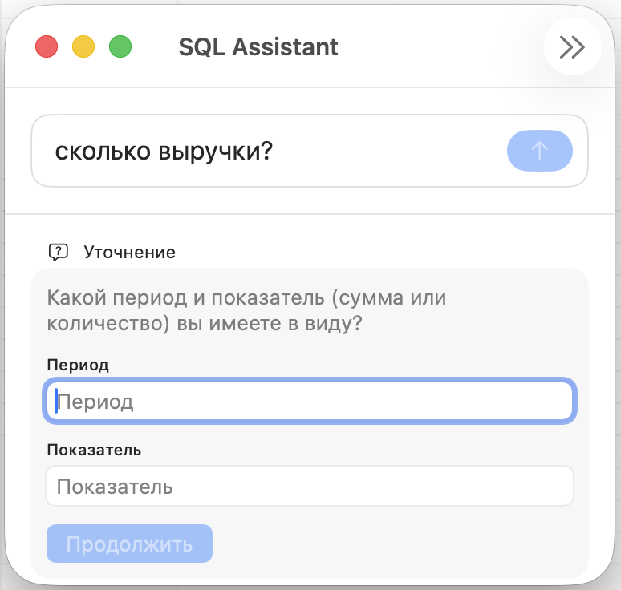
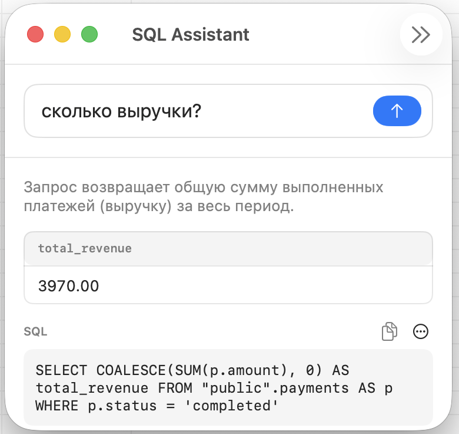
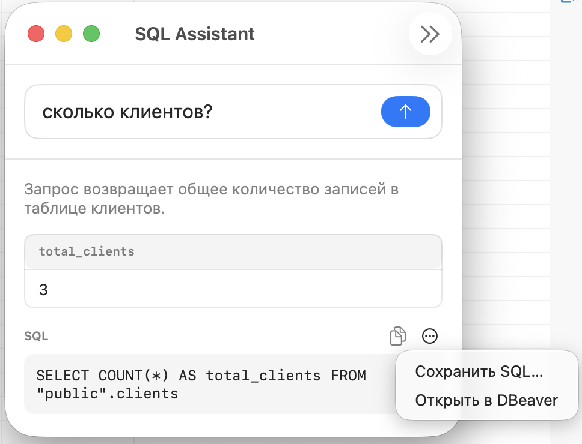

# SQL Assistant

Локальный помощник для PostgreSQL. Принимает вопросы на русском и использует Qwen 3.5 4B через Ollama.

- Читает таблицы, столбцы и внешние ключи выбранной схемы. Можно подключить словарь терминов.
- Составляет SQL, просит уточнить вопрос или сообщает, каких данных не хватает.
- Проверяет `SELECT` и по флагу `--execute` выполняет его с правами только на чтение.
- В мини-окне macOS можно выбрать базу, схему и таблицы, листать историю вопросов стрелками, копировать SQL и открывать его в DBeaver.

## Запуск

Нужны PostgreSQL, Ollama и `uv`. Запусти Ollama и выполни команды из папки проекта.

```bash
uv sync --frozen
ollama pull qwen3.5:4b
createdb sql_assistant_demo
psql -X -v ON_ERROR_STOP=1 -d sql_assistant_demo -f sql/demo.sql -f sql/reader.sql
```

Для мини-окна нужны macOS 14+ и инструменты командной строки Xcode.

```bash
./macos/run.sh
```

Пример запуска через CLI.

```bash
uv run --frozen python ask.py "Сколько клиентов в базе?" --execute
```

## Оценка

Сравнили число верных ответов до и после добавления списка связей для `JOIN`. Для SQL сверяли строки результата, для остальных вопросов проверяли выбор действия.

| Набор | До | После |
| --- | --- | --- |
| Подписки | 10/15 | [10/15](evaluation/joins_subscriptions.json) |
| Магазин | 2/10 | [3/10](evaluation/joins_shop.json) |
| Новые вопросы на JOIN | 3/5 | [3/5](evaluation/joins_new_shop.json) |

## Как выглядит приложение

<p>
  
  
</p>


